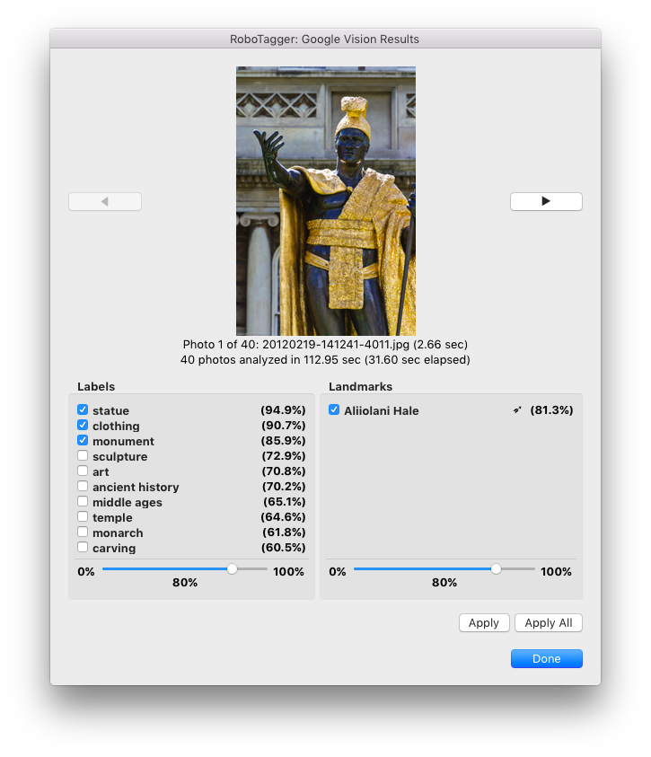
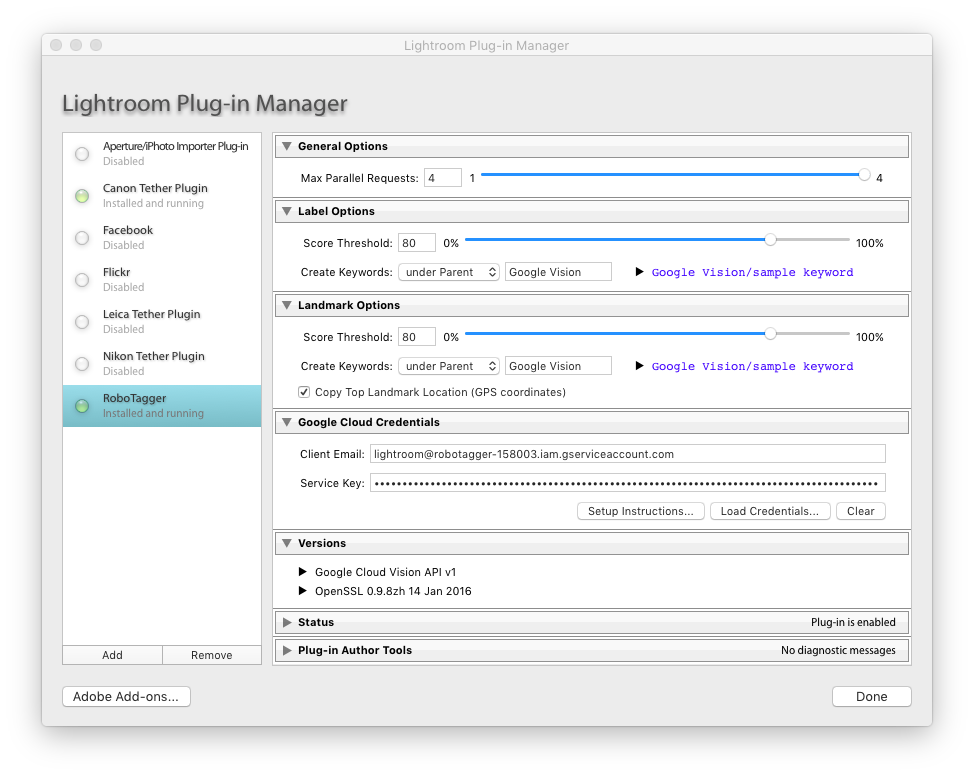

# RoboTagger v2.0

## Adobe Lightroom Classic Plug-In (Updated for 2024)

This plug-in will take all the selected photos and upload their thumbnails to Google Vision API for analysis. It will then allow you to attach the selected labels and landmarks as keywords to the photo in your Lightroom catalog.

**Version 2.0 Updates:**
- Compatible with Lightroom Classic 2024 (SDK 13.0+)
- Updated Google OAuth2 authentication endpoints
- Improved error handling and user experience
- Enhanced thumbnail quality for better AI analysis
- Better concurrent request management

See [other plug-ins](https://github.com/tjotala/lightroom-plugins).

## Installation

1. Download the `dist/robotagger.zip` distribution package
2. Unzip it to a convenient location; it will show up as folder named `robotagger.lrplugin`
3. Launch Lightroom
4. Select `File`, then `Plug-in Manager...`
5. Click on the `Add` button under the plug-in list on the left
6. Navigate to the location where you unzipped the plug-in
7. Click on the folder named `robotagger.lrplugin` and click on `Add Plug-in`

Be sure to read the following sections for critical dependencies.

## Usage

1. Launch Lightroom
2. Select one or more photos (no videos) in any of the catalog views
3. Select `File` then `Plug-in Extras...` and finally `Tag Photos with Google Vision`
4. A dialog opens to show the results as they arrive, with actions you can take

Note that it may take several seconds for each photo to be analyzed, so the plug-in issues several requests in parallel. The counter will show how many results are available.




## Dependencies

### Google Cloud Platform account

You will need a Google Cloud Platform service account configured to support Google Vision API requests in order to use this plug-in. Instructions can be found [here](https://cloud.google.com/vision/docs/setup) and [here](https://cloud.google.com/docs/authentication/getting-started). You **do not** need to create a storage bucket because this plug-in will not store your photos in the cloud.

**Important:** Make sure to enable the Cloud Vision API in your Google Cloud Console and ensure your service account has the necessary permissions.

Once you have set up your service account, you need to download the private key (JSON), and import it into the plug-in:

1. Launch Lightroom
2. Select `File`, then `Plug-in Manager...`
3. Select the plug-in from the list on the left
4. Click on the `Load Credentials...` button in the `Google Cloud Credentials` section
5. Select the JSON file and click on `Choose`
6. Click on the `Save` button to save the credentials in Lightroom's secure password store

```
IMPORTANT: DO NOT DELETE YOUR PRIVATE KEY!
```

Google only retains your public key.
This plug-in will store your private key and show it obscured in the UI, but as security measure it **will not** let you copy it back out.



### OpenSSL

Google Vision API requires its [JSON Web Token](https://developers.google.com/identity/protocols/oauth2/service-account) requests to be signed with the [`RSASSA-PKCS1-V1_5-SIGN`](https://www.ietf.org/rfc/rfc3447.txt) algorithm. There were no implementations of that readily available in Lua, and I did not feel like writing one. I simply launch OpenSSL to sign the token request with the private key extracted from the JSON file mentioned above.

You will need [OpenSSL](https://www.openssl.org/) installed on your system and available along the PATH. To test that everything is working, check the `Versions` section in the Plug-In Manager. It should show the OpenSSL version number, such as `OpenSSL 3.0.x` or newer.

**Note:** The plugin now uses the updated OAuth2 token endpoint (`oauth2.googleapis.com/token`) for better compatibility and security.

## Developers

Adobe Lightroom plug-ins are written in a subset of the [Lua](https://www.lua.org/) language, version 5.1. More information is available [here](https://developer.adobe.com/lightroom/).

Lightroom will run Lua code either directly as source code, or as a compiled bytecode. The repo contains a compiled distribution package. You can re-build that distribution image with [`rake`](http://rake.rubyforge.org/), even though that is not necessary. Make sure you're running Lua version 5.1, because Lightroom will reject code compiled with newer versions. On Mac OS X, you can install it with [`brew`](https://brew.sh/):

	$ brew install lua@5.1

If you have other versions of Lua installed, you may need to switch to the correct version:

	$ brew switch lua@5.1

The `Rakefile` assumes Lua v5.1 is available as `luac5.1`.

### Version 2.0 Changes

- **SDK Version**: Updated to 13.0 (compatible with Lightroom Classic 2024)
- **OAuth2 Endpoint**: Updated from deprecated `/oauth2/v4/token` to `/oauth2/token`
- **Error Handling**: Improved authentication and network error handling
- **Performance**: Better concurrent request management and larger thumbnails
- **Compatibility**: Maintains backward compatibility with older Lightroom versions (minimum SDK 10.0)
